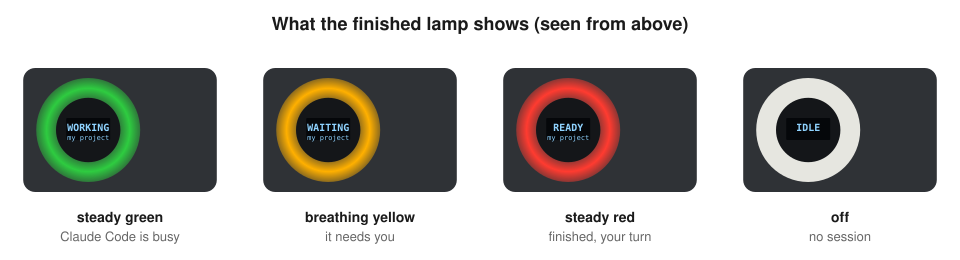
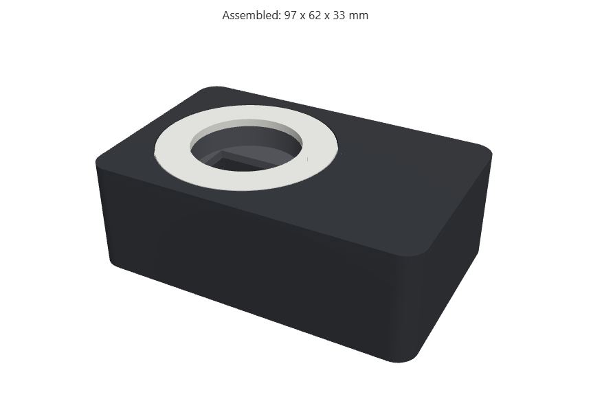
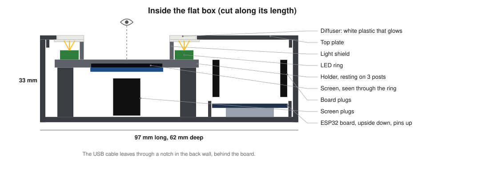

# Blueprint

This is the design. For step-by-step assembly instructions, see [BUILD_GUIDE.md](BUILD_GUIDE.md).

## 1. Concept

A status lamp for Claude Code that sits on the desk: a flat dark box, 97 x 62 x 33 mm. On its top
face a ring of coloured light frames a small screen. The screen sits just behind the LED ring and is
seen through the ring's hole, and it shows the state in words plus the project name.



| Letter | State | Ring | Screen | Claude Code moment |
|---|---|---|---|---|
| `G` | Working | steady green | `WORKING` | You submitted a prompt. |
| `Y` | Waiting | breathing yellow | `WAITING` | It asks for permission or asks you a question. |
| `R` | Ready | steady red | `READY` | It finished its answer, or a session started. |
| `O` | Idle | off | `IDLE` | The session ended. |

The message to the board is one line of text: the letter, a space, and the project name.
For example `Y athlete paper` or `R veteran paper`. You type the same message by hand in the
simulator, so a simulation that behaves well means the real device will behave the same.

Two design rules make it look good rather than like a tangle of wires:

- **No soldering.** Use a board and modules sold with pre-soldered headers and connect them with
  female-to-female jumper wires that simply push on.
- **Diffuse the light.** Bare LEDs are small harsh points. Behind something translucent they turn
  into a soft glow that looks deliberate. Here a thin white plastic ring on the top face does that.
- **Only as deep as needed.** The board lies beside the ring, not under it, so the box only has to
  be as deep as the jumper plugs.

## 2. Shopping list

ESP32 version with ring and screen. AZ-Delivery is a convenient single source and also sells on
Amazon.it. The same parts cost about half on AliExpress, with two to four weeks of delivery.

| # | Part | Search for | Approx. price |
|---|---|---|---|
| 1 | ESP32 board | "ESP32 NodeMCU" or "ESP32 DevKit V1", CP2102 USB chip, **with soldered pins** | 11 EUR |
| 2 | LED ring | "WS2812B LED ring", 12 LEDs, 50 mm outside, **hole of 35 mm or more** | 6 EUR |
| 3 | OLED screen | "0.96 inch OLED SSD1306 I2C 128x64" | 8 EUR |
| 4 | Jumper wires | "jumper wire female to female" (F2F) | 7 EUR |
| 5 | USB cable | micro USB or USB C to match the board, **must be a data cable** | a few EUR |

Total about 30 to 35 EUR, plus 10 to 20 EUR to have the case printed if you have no printer.

Points to check before buying:

- Avoid boards marked "unverlötet" or "unsoldered". Those need the pins soldered.
- A charge-only USB cable cannot upload code. This is a frequent beginner problem.
- LED rings usually arrive with three bare metal pads, not pins. Pick one of three fixes:
  buy a ring sold "with pre-soldered wires", ask someone with a soldering iron (a fab lab takes
  five minutes), or use an "8 LED WS2812 stick" that comes with pins.
- An Arduino Nano works too if the lamp always stays next to the computer on USB. An ESP32 costs
  about the same and adds WiFi, which the roadmap below uses.
- A beginner starter kit (20 to 30 EUR) is a good extra for a first evening of practice.

## 3. Wiring

All connections are push-on jumper wires: 3 for the ring and 4 for the screen.

### ESP32 DevKit V1

| From | To ESP32 pin |
|---|---|
| Ring DIN | GPIO 13 (`D13`) |
| Ring VCC (5V) | `VIN` (5V from USB) |
| Ring GND | `GND` |
| OLED SDA | GPIO 21 (`D21`) |
| OLED SCL | GPIO 22 (`D22`) |
| OLED VCC | `3V3` |
| OLED GND | `GND` |

### Arduino Nano

| From | To Nano pin |
|---|---|
| Ring DIN | `D6` |
| Ring VCC | `5V` |
| Ring GND | `GND` |
| OLED SDA | `A4` |
| OLED SCL | `A5` |
| OLED VCC | `5V` |
| OLED GND | `GND` |

The ESP32 runs at 3.3 V. The ring and screen chosen here work fine with it.

## 4. Firmware

One sketch, [firmware/sketch/sketch.ino](../firmware/sketch/sketch.ino), runs on both boards.
It picks pins and ring size automatically from the board you select in the Arduino IDE.

Libraries, installed from the Arduino IDE Library Manager:

- Adafruit NeoPixel
- Adafruit GFX Library
- Adafruit SSD1306

Settings at the top of the sketch:

| Setting | Nano | ESP32 |
|---|---|---|
| Ring data pin | 6 | 13 |
| Number of LEDs | 16 | 12 |
| Serial speed | 9600 | 9600 |
| Ring brightness | 150 of 255 | 150 of 255 |

Change the number of LEDs if your ring differs. That single number is the only change for a 12 or
16 LED ring. The serial speed stays at 9600 on both boards, because on the Nano faster speeds can
lose characters while the breathing animation updates the ring.

## 5. Host side

[host/claude_light.py](../host/claude_light.py) is called by Claude Code hooks. It reads the
project name from the hook's input, which is the folder name of the session, finds the board's USB
port, and sends one line. It never fails a hook: if the lamp is unplugged it simply does nothing.

Opening a USB serial port resets many boards, and a freshly reset board needs about two seconds
before it listens. The script therefore waits two seconds after opening the port by default. You can
lower that wait once you have checked that your board does not reset, see
[host/README.md](../host/README.md).

## 6. Enclosure

A 3D-printed flat box in four parts, all in [enclosure/](../enclosure/). The STL files are ready to
print, and [enclosure/make_case.py](../enclosure/make_case.py) rebuilds them from your own part sizes.





| Part | Colour | Role |
|---|---|---|
| Tray | dark | Floor, walls, rails for the board, three posts, USB notch at the back |
| Holder | dark | Screen underneath, LED ring on top, a light shield tube between them |
| Top | dark | Top plate with a round hole |
| Diffuser | white | The glowing ring, it sits in the hole of the top |

How it fits together:

- **The board lies upside down** on the floor, chip side down and pins up, so the jumper plugs push
  on from above and the USB socket faces a notch in the back wall.
- **The screen is taped under the holder**, its glass in a window, and is seen through the ring.
- **The light shield**, a short tube between the ring and the screen, keeps the LED glow off the text.
- **The top presses down** on the tube, which holds the diffuser, ring, holder and screen in place.
  Nothing needs screws or glue.

The depth comes from the jumper plugs, which stand 14 mm tall on the pins. About 33 mm is close to
the minimum without soldering. Wires soldered straight onto the board would allow about 21 mm.

Measure the real parts before printing: rings, screens and boards vary by a few millimetres. The
script checks that nothing collides after you enter your sizes, see
[enclosure/README.md](../enclosure/README.md).

Without a printer, a frosted glass jar over the ring works as a quick first cover, with the screen
beside it.

## 7. Timeline for a first build

| Session | Work |
|---|---|
| One evening | Install the Arduino IDE, make an LED blink with the built-in examples. |
| One afternoon | Wire the ring and the screen, flash the sketch, connect the hooks. |
| A few hours, mostly waiting | Print the four case parts, or collect them from a print service. |
| Half an hour | Assemble the case. |

Before buying anything, the whole circuit runs in the free Wokwi simulator, see
[simulation/README.md](../simulation/README.md).

## 8. Roadmap: wireless lamp over MQTT (ESP32 only)

**Level one** is this repository: the ESP32 runs the same sketch over USB.

**Level two** sends the state over WiFi, about 40 extra lines of code. The free Wokwi simulator can
connect out to the internet through its virtual network `Wokwi-GUEST`, but your computer cannot
connect in to the simulated board. A message broker in the middle solves this, using the MQTT
protocol:

```
claude_light.py  --publish-->  public MQTT broker  --subscribe-->  ESP32
```

Both sides only connect outward, so it works the same in the simulator and on real hardware, and
the lamp can sit anywhere with WiFi. The two-second reset wait also disappears.

Two notes for level two:

- Public brokers are open. Use a long random topic name and send nothing sensitive.
- Expect about two hours, mostly spent understanding the broker idea rather than writing code.

## 9. What this project teaches

Most of it transfers to later Arduino and ESP32 work:

- the write, upload and debug workflow with the serial monitor;
- driving addressable LEDs and small screens;
- I2C, the bus shared by most sensors and displays;
- a computer talking to a board over serial;
- at level two, the publish and subscribe pattern behind most connected devices.

The same skills build sensor stations that log temperature, air quality or noise to a Python
script. Only the Claude Code hook part is specific to this lamp.

## 10. Names, licenses and publishing

Not legal advice, but the usual practice for a hobby project:

- **Hardware.** Arduino board designs are open source and the ESP32 is a commercial chip anyone may
  build on. Using and sharing a project built on either is what they are for.
- **Code.** The sketch and the Python script are released under MIT, see [LICENSE](../LICENSE).
  The Adafruit libraries are referenced, not copied, and keep their own licenses: BSD for GFX and
  SSD1306, LGPL for NeoPixel.
- **Names.** "Arduino", "Claude" and "Anthropic" are trademarks. Describe the project as
  "built with Arduino" or "a status lamp for Claude Code", never with a name or logo that implies an
  official product.
- **Selling.** Selling physical devices in the EU would bring product rules such as CE marking and
  electrical safety. Sharing the design and code does not.
