# Build guide: from parts to a working prototype

This guide takes you from an empty desk to a finished lamp on top of it. It assumes no electronics
experience and needs no soldering. Plan on a weekend, split across a few short sessions.


| Stage | What you do | Time |
|---|---|---|
| 0 | Try the circuit in the Wokwi simulator | 30 min |
| 1 | Order the parts | 10 min, then wait for delivery |
| 2 | Prepare the computer | 45 min |
| 3 | First upload: blink the board's own LED | 20 min |
| 4 | Connect and test the screen | 20 min |
| 5 | Connect and test the LED ring | 20 min |
| 6 | Connect the lamp to Claude Code | 30 min |
| 7 | Build the enclosure | 1 to 2 hours |
| 8 | Final checks: the prototype is done | 15 min |

---

## Stage 0. Simulate first

Before spending anything, run the circuit in the free Wokwi simulator, see
[simulation/README.md](../simulation/README.md). Use the **ESP32** version, because it matches the
parts below. If the simulated ring and screen respond to `G test`, `Y test` and `R test`, the real
device will behave the same way.

This is what the loaded project looks like, with the code on the left and the circuit on the right:

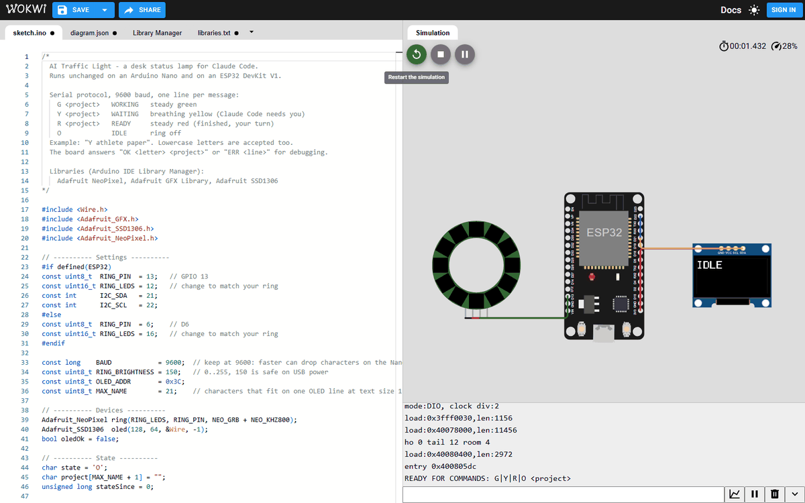

And this is what each command does in the simulator. The serial monitor at the bottom shows the
board's `OK` reply to each line.

| Typed in the serial monitor | Result |
|---|---|
| nothing yet, just started |  |
| `G athlete paper` | 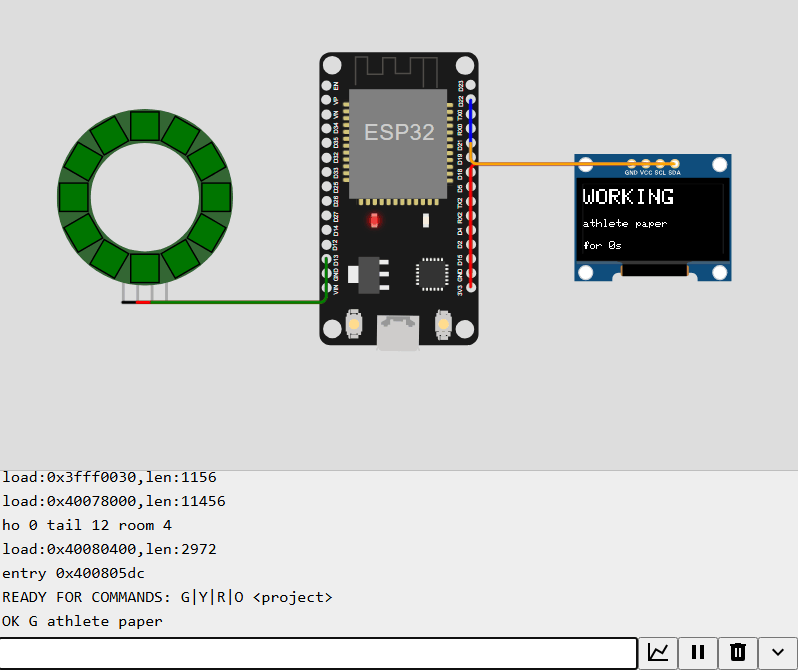 |
| `Y athlete paper` | 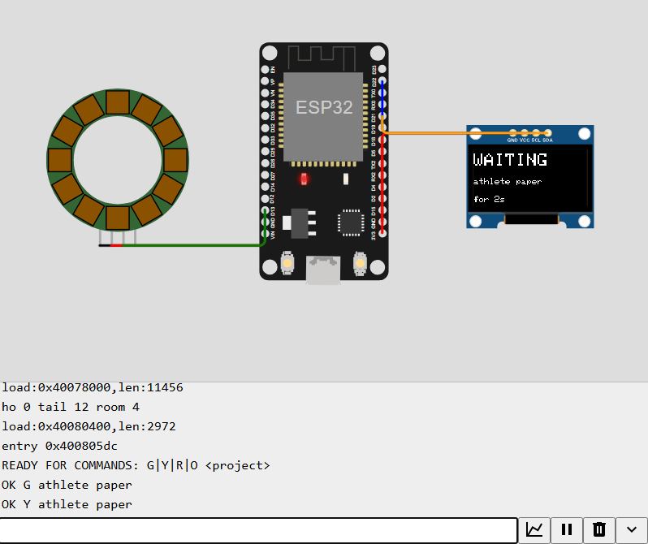 |
| `R veteran paper` | 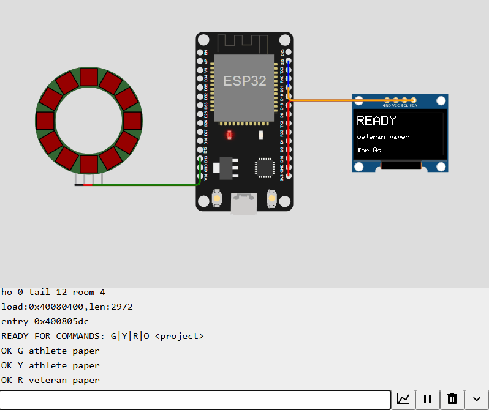 |
| `O` | 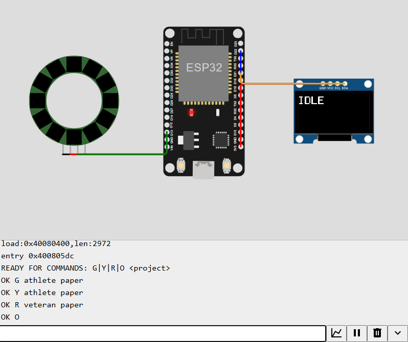 |

The simulator draws the LEDs darker than real ones, and yellow comes out orange-brown.
A real ring at the same setting looks clearly yellow.

---

## Stage 1. Parts to buy

### Required parts

| # | Part | Qty | Search for | Approx. price | Check before ordering |
|---|---|---|---|---|---|
| 1 | ESP32 development board | 1 | "ESP32 DevKit V1" or "ESP32 NodeMCU", CP2102 USB chip | 11 EUR | **Pins already soldered.** Avoid "unverlötet" or "unsoldered". |
| 2 | WS2812B LED ring, 12 LEDs, about 50 mm | 1 | "WS2812B ring 12 LED" | 6 EUR | **Sold with wires attached**, ideally ending in female Dupont plugs. See the note below. |
| 3 | OLED screen 0.96 inch, 128x64, SSD1306, I2C | 1 | "0.96 OLED SSD1306 I2C 128x64" | 8 EUR | **4 pins** labelled GND, VCC, SCL, SDA. Not the 7-pin SPI version. |
| 4 | Jumper wires, female to female | 1 set | "jumper wire female female 20 cm" (F2F) | 7 EUR | 10 to 20 cm long. A mixed set (F-F, M-F, M-M) is fine. |
| 5 | USB cable | 1 | micro USB or USB-C, to match the board | 3 to 5 EUR | **Data cable**, not charge-only. A cable from an old phone usually works. |

**Total: about 30 to 35 EUR** at AZ-Delivery or Amazon.it. On AliExpress the same parts cost about
half, with two to four weeks of delivery.

### What each part looks like

The drawings below show what to look for. Real boards vary in colour and small details, but the
printed pin labels are always the same.

**1. ESP32 DevKit V1 board.** About 5 cm long, with 15 pins on each side and a USB socket at one end.

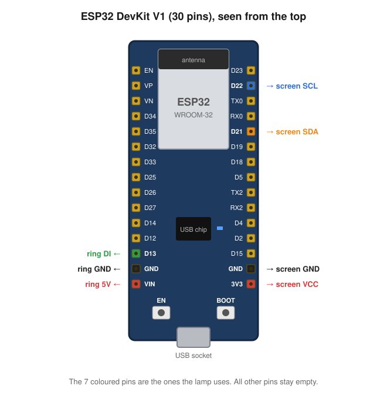

**2. WS2812B LED ring.** A flat ring of 12 small square LEDs, with 4 pads on the back.

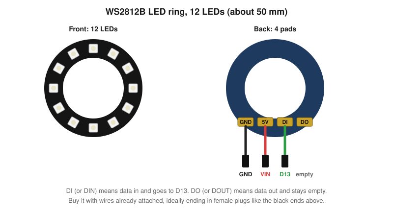

**3. OLED screen.** About 2.7 cm wide, with 4 pins along the top edge.

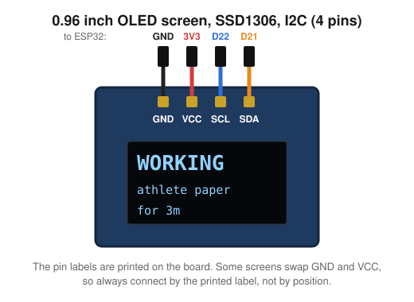

**4. Jumper wires.** Coloured wires with a black plastic socket at each end.

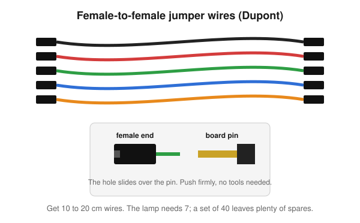

**5. USB cable.** It must carry data, not only power.

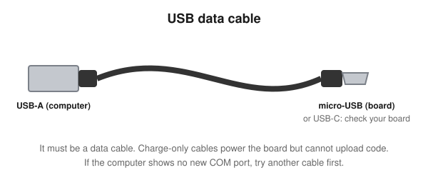

**The LED ring is the one part that may need soldering.** Most rings arrive with three bare metal pads.
Pick one of these:

1. Buy a ring sold **with pre-soldered wires** (best choice). If the wires end in female plugs, they push
   straight onto the board. If they end in male pins, add female-to-female jumpers between them and the
   board. If they end in bare copper, you need option 2.
2. Buy the plain ring and ask someone with a soldering iron, for instance at a university fab lab.
   It takes five minutes.
3. Replace the ring with an **8 LED WS2812 stick with pins** and change `RING_LEDS` to 8 in the sketch.

### Optional but useful

| Part | Why | Approx. price |
|---|---|---|
| A second ESP32 board | Spare in case you damage one while learning. | 11 EUR |
| Beginner starter kit for ESP32 or Arduino | Extra parts and tutorials for a first evening of practice. | 20 to 30 EUR |
| Small multimeter | Checks a cable or a connection when something does not light. | 10 to 15 EUR |

### Enclosure material

Choose one for the first prototype. You can upgrade later.

| Option | Material | Approx. price |
|---|---|---|
| Glass jar | A frosted glass jar, or a clear one plus frosted window film or baking paper inside | 0 to 5 EUR |
| Lamp shade | A small paper or plastic shade, for example from IKEA | 5 to 10 EUR |
| Wooden box | A small craft box plus a frosted acrylic sheet on top | 10 to 15 EUR |

Plus double-sided foam tape or small Velcro dots to hold the parts in place.

### Tools

None are required. Scissors and a craft knife help for the enclosure.

### If you choose the Arduino Nano instead

Replace part 1 with an **Arduino Nano with soldered pins** (often sold with a CH340 USB chip, about
8 to 10 EUR). Everything else stays the same. The Nano has no WiFi, so the wireless upgrade at the
end does not apply.

---

## Stage 2. Prepare the computer

1. **Install the Arduino IDE 2** from the official Arduino website.
2. **Add ESP32 support.** Open the Boards Manager (the board icon on the left), search for
   **esp32 by Espressif Systems** and click Install.
3. **Install the three libraries.** Open the Library Manager (the books icon) and install
   **Adafruit NeoPixel**, **Adafruit GFX Library** and **Adafruit SSD1306**. Accept installing their
   dependencies when asked.
4. **Plug in the board** with the USB cable. In Windows Device Manager, under "Ports (COM & LPT)",
   a new COM port should appear, for example `COM5`.
   - If nothing appears, try another cable first: charge-only cables are the usual cause.
   - If an unknown device appears instead, install the USB driver for your board's chip:
     **CP210x** from Silicon Labs, or **CH340** from WCH. The chip name is printed on the board, next to
     the USB socket.

---

## Stage 3. First upload: blink the board's LED

This proves the computer, cable and board work, before any wiring.

1. In the Arduino IDE choose **Tools > Board > esp32 > DOIT ESP32 DEVKIT V1**
   (or "ESP32 Dev Module" if that one is missing).
2. Choose **Tools > Port** and pick the COM port from stage 2.
3. Open **File > Examples > 01.Basics > Blink**.
4. Near the top, add the line `#define LED_BUILTIN 2` if the IDE complains that `LED_BUILTIN` is unknown.
5. Click **Upload** (the right arrow).
6. A small blue LED on the board blinks once per second. Done.

If the upload stops at `Connecting........`, hold the **BOOT** button on the board until the upload
percentage starts, then let go.

---

## Stage 4. Connect and test the screen

**Always unplug the USB cable before changing wires.**

Here is the complete wiring you will have at the end of stage 5. This stage does the screen part, on
the right of the drawing.

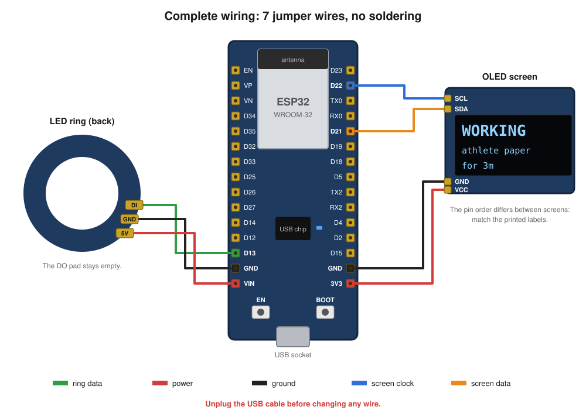

Connect 4 female-to-female jumpers from the screen to the board:

| Screen pin | ESP32 pin | Suggested wire colour |
|---|---|---|
| GND | GND | black |
| VCC | 3V3 | red |
| SCL | D22 | blue |
| SDA | D21 | orange |

Then:

1. Open [firmware/sketch/sketch.ino](../firmware/sketch/sketch.ino) in the Arduino IDE. If it asks to
   move the file into a folder called `sketch`, it is already in one, so open the file from that folder.
2. Plug the USB cable back in, check the board and port, and click **Upload**.
3. The screen shows **IDLE**.
4. Open **Tools > Serial Monitor**. Set the speed to **9600 baud** and the line ending to **Newline**.
5. Type `G test` and press Enter. The screen shows **WORKING**, then `test`, then a timer.

If the screen stays black:

- Check that SDA and SCL are not swapped. This is the most common mistake.
- The Serial Monitor may print `WARN OLED not found`. Some screens use the address 0x3D: change
  `OLED_ADDR` in the sketch to `0x3D` and upload again.

---

## Stage 5. Connect and test the LED ring

Unplug the USB cable, then connect the ring with 3 wires. This is the left part of the wiring drawing
in stage 4.

| Ring pad | ESP32 pin | Suggested wire colour |
|---|---|---|
| GND | GND (a second GND pin) | black |
| 5V or VCC | VIN | red |
| DIN or DI (data **in**) | D13 | green |

The ring's fourth pad, **DOUT** or DO, stays empty. It is for chaining a second ring. Using DOUT by
mistake is the most common reason a ring stays dark, so check the small arrow or the label.

Plug in the USB cable. The sketch is already on the board, so no new upload is needed. In the Serial
Monitor type:

| You type | The ring should | The screen should show |
|---|---|---|
| `G test` | glow steady green | WORKING |
| `Y test` | breathe yellow, about 3 s per breath | WAITING |
| `R test` | glow steady red | READY |
| `O` | turn off | IDLE |

If your ring has a different number of LEDs, change `RING_LEDS` in the sketch and upload again.
If the colours look too strong, lower `RING_BRIGHTNESS` from its default of 150. At the default value the ring draws well under
the 500 mA a USB port can supply.

**Close the Serial Monitor when you are done.** Only one program can use the port at a time, and the
Claude Code script needs it next.

---

## Stage 6. Connect the lamp to Claude Code

Follow [host/README.md](../host/README.md). In short:

1. Install the serial library:
   ```bash
   python -m pip install -r host/requirements.txt
   ```
2. Check the lamp is found:
   ```bash
   python host/claude_light.py --list
   ```
3. Send a test state:
   ```bash
   python host/claude_light.py Y "athlete paper"
   ```
4. Paste the hooks from [host/hooks-example.json](../host/hooks-example.json) into your Claude Code
   settings, with the real path of this folder, and restart Claude Code.
5. Send a prompt in Claude Code. The lamp turns green while it works and red when it finishes.

---

## Stage 7. Build the enclosure

1. **Plan the layout.** The ring goes at the top or centre, facing the translucent cover. The screen
   goes where you can read it, behind a small window or simply outside the cover at the base. The board
   sits at the bottom with its USB socket towards the back.
2. **Make the cable exit.** Cut a small notch or hole for the USB cable at the back of the base.
3. **Fix the parts.** Use double-sided foam tape or Velcro dots on the back of the board, ring and
   screen. Foam tape also keeps the metal pins away from anything conductive.
4. **Diffuse the light.** Leave 2 to 5 cm between the ring and the cover. More distance gives a softer,
   more even glow. If you still see individual dots, add a layer of baking paper or tracing paper inside
   the cover.
5. **Tidy the wires.** Coil the extra length loosely and hold it with a small cable tie. Do not pull on
   the jumpers: push-on connections can slip off.
6. **Check the heat.** At this brightness nothing gets more than lukewarm, so paper and wood are safe.

---

## Stage 8. Final checks: the prototype is done when

- [ ] It runs only from the USB cable, with nothing else connected.
- [ ] Each Claude Code moment shows the right state: green on a prompt, yellow on a permission
      request, red when it finishes, off when the session ends.
- [ ] The project name on the screen matches the folder you are working in.
- [ ] Unplugging the lamp does not disturb Claude Code, and plugging it back in works again.
- [ ] Nothing rattles loose when you move the lamp.
- [ ] The glow is soft and even, with no harsh dots.

---

## After the prototype: towards a final product

| Version | Change | Effort |
|---|---|---|
| v1 Prototype | This guide: jumper wires, jar or shade. | a weekend |
| v2 Tidy | Shorter jumpers cut to length, or a small solderless terminal board. Lower the boot delay to 0 if your board does not reset, see [host/README.md](../host/README.md). | an evening |
| v3 Custom case | A 3D-printed case with a window for the screen and a diffuser on top, from a fab lab or an online print service for a few euros. | a few hours of design |
| v4 Wireless | The ESP32 receives the state over WiFi through an MQTT broker, so the lamp can sit anywhere. See the roadmap in [BLUEPRINT.md](BLUEPRINT.md#8-roadmap-wireless-lamp-over-mqtt-esp32-only). | about two hours |

Selling devices, rather than sharing the design, would bring EU product rules such as CE marking,
see [BLUEPRINT.md](BLUEPRINT.md#10-names-licenses-and-publishing).

---

## Troubleshooting

| Symptom | Likely cause | Fix |
|---|---|---|
| No COM port appears | Charge-only cable, or missing driver | Try another cable, then install the CP210x or CH340 driver. |
| Upload stops at `Connecting...` | ESP32 not in upload mode | Hold the BOOT button until the upload starts. |
| Upload says the port is busy | Serial Monitor or the hook script is using it | Close the Serial Monitor and try again. |
| Screen black, `WARN OLED not found` | SDA and SCL swapped, or address 0x3D | Swap the two wires, or set `OLED_ADDR` to `0x3D`. |
| Ring dark | Wire on DOUT instead of DIN, or a loose jumper | Move the data wire to DIN and press all plugs firmly. |
| Only some LEDs light | `RING_LEDS` smaller than the real ring | Set it to the number of LEDs on your ring. |
| Wrong colours, for example red shows green | Ring uses a different colour order | In the sketch change `NEO_GRB` to `NEO_RGB`. |
| Lamp ignores Claude Code but works in the Serial Monitor | Serial Monitor still open, or wrong path in the hooks | Close the monitor, check the path in your settings, run `--list`. |
| Lamp misses some states | Board resets on each message and the boot delay is too short | Set `CLAUDE_LIGHT_BOOT_DELAY` back to 2. |
