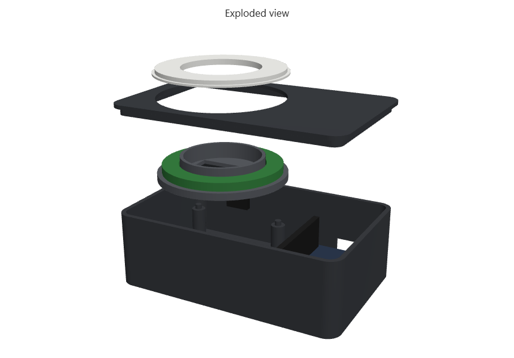
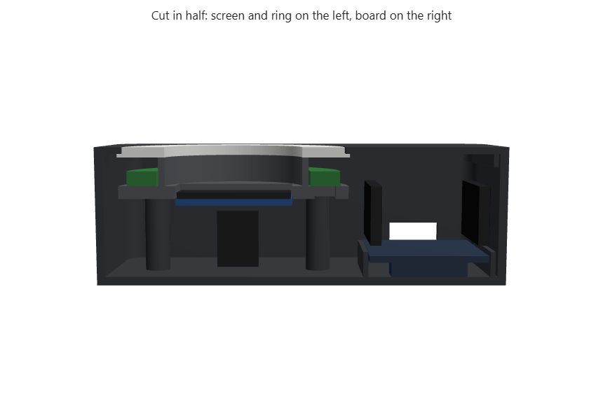

# 3D-printed case

A flat box, 97 x 62 x 33 mm. On top, a ring of light frames the screen. The board lies beside
the ring inside, so the box is only as deep as the jumper plugs need.


| Exploded | Cut in half |
|---|---|
|  |  |

## The four parts

| Part | File | Colour | What it does |
|---|---|---|---|
| Tray | [stl/tray.stl](stl/tray.stl) | dark | Floor and walls, rails that hold the board, three posts for the holder, USB notch at the back |
| Holder | [stl/holder.stl](stl/holder.stl) | dark | Screen underneath, LED ring on top, light shield between them |
| Top | [stl/top.stl](stl/top.stl) | dark | Top plate with a round hole, clicks into the tray |
| Diffuser | [stl/diffuser.stl](stl/diffuser.stl) | **white or natural** | The glowing ring. It drops into the hole of the top |

The four parts use about 40 to 50 g of plastic. The walls and floor are only 2 mm thick, so they
print almost solid whatever the infill. With the electronics inside, the finished lamp weighs about
75 to 85 g. The dark parts can be black or dark grey PLA. The diffuser should be
white or "natural" (translucent) PLA or PETG, so the light shines through it.

## Before printing: measure your parts

The case is built from typical sizes. Real parts vary by a few millimetres between sellers, so
measure yours with a caliper first and change the numbers at the top of
[make_case.py](make_case.py):

| Setting | Typical value | What to measure |
|---|---|---|
| `RING_OD`, `RING_ID`, `RING_T` | 50, 36, 3.5 mm | outer diameter, hole diameter and thickness of the LED ring |
| `OLED_PCB` | 27.3 x 27.8 mm | the screen's circuit board |
| `OLED_GLASS` | 26.7 x 19.3 mm | the glass on the front of the screen |
| `BOARD` | 28.3 x 51.5 mm | the ESP32 board |
| `PLUG_H` | 14 mm | the black plug of one jumper wire |

The ring's hole must be at least about 33 mm, or the screen will not show through it.

Then rebuild the files:

```bash
python -m pip install manifold3d numpy playwright
```

```bash
python -m playwright install chromium
```

```bash
python enclosure/make_case.py
```

The script writes new STL files and preview images. It also places simplified copies of the ring,
screen, board and plugs inside the case and checks that nothing overlaps. It prints
`collision check: OK, nothing overlaps` when the parts fit, or names the parts that collide.

## Printing

| Setting | Value |
|---|---|
| Layer height | 0.2 mm |
| Walls | 3 perimeters |
| Infill | 15 to 20 % |
| Supports | none needed |

Print orientation:

- **Tray**: upright, floor on the bed.
- **Holder**: plate on the bed, tube pointing up.
- **Top**: upside down, so the smooth top face is on the bed and the lip points up.
- **Diffuser**: upside down, flat top face on the bed.

If you have no printer, a university fab lab or an online service prints the four parts for about
10 to 20 EUR. Upload the four STL files and choose PLA, with the diffuser in white.

## Assembly

1. **Connect the wires to the board first**, outside the case, following the wiring in
   [docs/BUILD_GUIDE.md](../docs/BUILD_GUIDE.md). Plug the screen and the ring in, and check that
   the lamp works on the desk before closing anything.
2. **Lay the board upside down** in the tray between the two rails, chip side down and pins up,
   with its USB socket at the notch in the back wall. A small piece of foam tape keeps it still.
3. **Stick the screen under the holder**, glass facing up into the rectangular window, with its pins
   towards the back of the box. Two small pieces of double-sided tape are enough.
4. **Put the LED ring on the holder** around the tube, LEDs facing up, with its wires going down
   through the slot that faces the board.
5. **Set the holder on the three posts.** The small pins on the posts fit into its holes.
6. **Drop the diffuser into the top**, then press the top onto the tray. The tube of the holder
   pushes the diffuser up against the top, which holds everything in place.
7. **Plug in the USB cable** through the notch at the back.

## Making it thinner

The depth is set by the jumper plugs, which are 14 mm tall and stand on top of the pins. Without
soldering, about 33 mm is close to the minimum. With soldering, wires soldered straight onto the
board and screen would allow a box of about 21 mm: set `PLUG_H` to 3 and `DIFFUSE_GAP` to 3 in the script.
