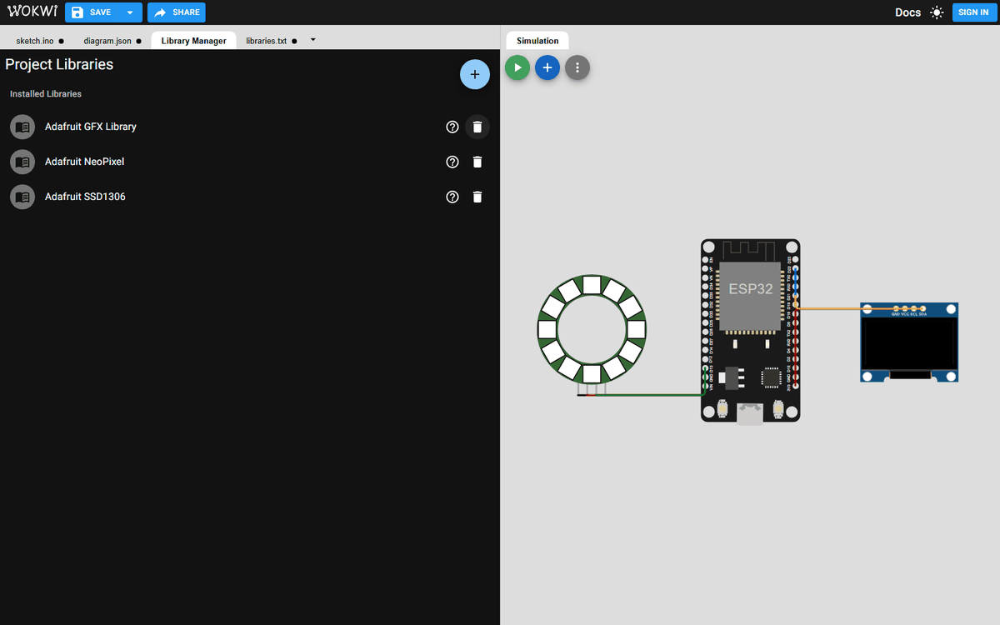
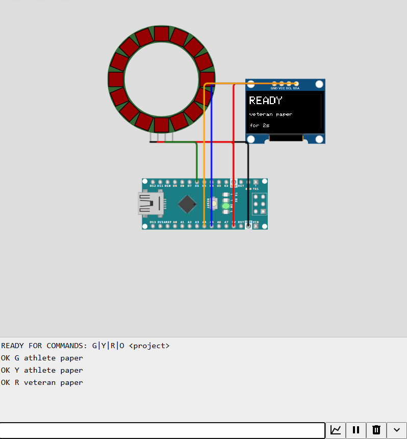

# Run the lamp in the Wokwi simulator

Wokwi is free and runs in the browser, with no account needed. Pick the board you plan to buy:
[esp32](esp32/) for the shopping list in the build guide, or [nano](nano/).

1. Go to [wokwi.com](https://wokwi.com) and under "Start from scratch" choose **ESP32** or **Arduino Nano**.
2. Replace the content of the `sketch.ino` tab with [firmware/sketch/sketch.ino](../firmware/sketch/sketch.ino).
   The same file works for both boards.
3. Replace the content of the `diagram.json` tab with `esp32/diagram.json` or `nano/diagram.json`.
   The ring and the screen appear already wired.
4. Add the three libraries. Open the **Library Manager** tab, click the round **+** button, type the
   name and click it in the list. Do this for **Adafruit NeoPixel**, **Adafruit GFX Library** and
   **Adafruit SSD1306**. Wokwi saves them in a `libraries.txt` tab, whose content should match
   [libraries.txt](libraries.txt).
5. Press the green play button. The first build waits in Wokwi's free queue for up to a minute.



The screen starts on `IDLE` with the ring off. Then type in the serial monitor at the bottom and
press Enter after each line:

```
G athlete paper
Y athlete paper
R veteran paper
O
```

| You type | Ring | Screen |
|---|---|---|
| `G athlete paper` | steady green | `WORKING`, athlete paper |
| `Y athlete paper` | breathing yellow | `WAITING`, athlete paper |
| `R veteran paper` | steady red | `READY`, veteran paper |
| `O` | off | `IDLE` |

The first letter sets the state and the rest is the project name. This is exactly the message the
Python script sends from the Claude Code hooks, so a simulation that behaves well means the real
device will behave the same. The board answers each line with `OK` and the state, as below.

| ESP32 | Arduino Nano |
|---|---|
|  |  |

The simulator draws the LEDs darker than real ones, so yellow looks orange-brown on screen.
The full set of screenshots is in [docs/BUILD_GUIDE.md](../docs/BUILD_GUIDE.md#stage-0-simulate-first).

If a wire looks detached after you move parts around, check the pin names in the wiring tables of
[docs/BLUEPRINT.md](../docs/BLUEPRINT.md#3-wiring).
